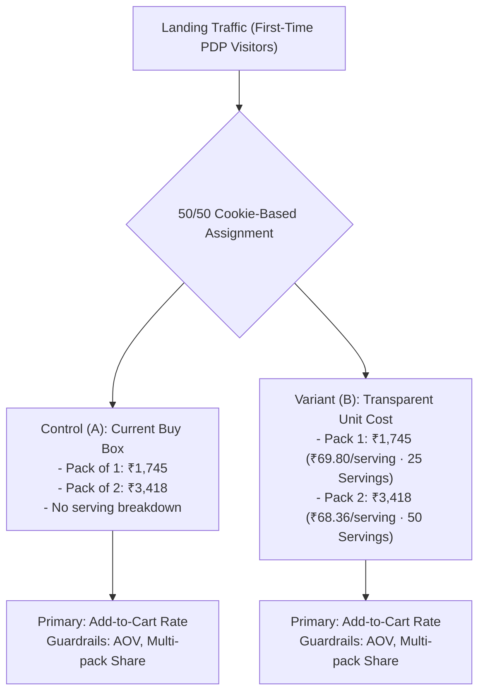

# Formal A/B Experimentation Plan

**Project:** Wellbeing Nutrition Korean Marine Collagen Peptides CRO Optimisation  
**Author:** Senior Product Manager & Experimentation Analyst  
**Date:** October 25, 2026  
**Status:** Experiment Specifications Ready for Technical Review  
**Dedicated Branch:** `feature/collagen-cro-experience`  

---

## 1. Experimentation Framework & Statistical Standards

To guarantee scientific rigor, all tests are designed as **isolated, single-variable experiments**. Multiple unrelated changes will not be bundled into a single variant, ensuring that any measured conversion lift or degradation is unambiguously attributable to the specific intervention.

### Statistical Parameters & Decision Rules
* **Significance Level ($\alpha$):** 0.05 (95% two-tailed confidence interval).
* **Statistical Power ($1 - \beta$):** 0.80 (80% power to detect genuine effects).
* **Sample Size Determination Methodology:** Two-tailed independent two-sample proportion z-test:
  $$n = \frac{\left(Z_{\alpha/2}\sqrt{2\bar{p}(1-\bar{p})} + Z_{\beta}\sqrt{p_1(1-p_1) + p_2(1-p_2)}\right)^2}{(p_2 - p_1)^2}$$
* **Missing Baseline Data Disclosure:** Actual historical baseline conversion rates, daily visitor traffic volumes, and seasonal standard deviations are proprietary company data and have **not been assumed or invented**. Formal sample sizes and test duration estimates in this plan use **clearly labelled illustrative benchmarks** until verified analytics access is provided.
* **Stopping Rules:**
  1. *Fixed Sample Horizon:* Tests run until the pre-calculated sample size per variant is reached. No early peeking or ad-hoc stopping.
  2. *Minimum Duration:* Minimum test duration of 14 full days (two full business/weekend cycles) to guard against day-of-week novelty bias.
  3. *Safety Guardrail Breach:* If any variant causes a statistically significant drop ($\ge 5\%$ degradation at $p < 0.01$) in Average Order Value (AOV) or Gross Contribution Margin over a 5-day rolling window, the experiment is aborted immediately.

---

## 2. Experiment A: Transparent Price-Per-Serving Information

### 2.1 Strategic Rationale & Hypothesis
* **Addressed Friction:** High perceived upfront cost of ₹1,745 for 200 g creates sticker shock for first-time shoppers who do not realize the tub contains 25 servings (₹69.80 / day).
* **Formal Hypothesis:**  
  *If* we display the verified price per serving (`₹69.80 / serving`) and serving count (`25 Servings`) directly beneath the pack selector in the buy box,  
  *then* Add-to-Cart (ATC) rate among first-time visitors will increase,  
  *because* prospective buyers will reframe the cost as an affordable daily routine (~₹70/day) rather than an expensive discretionary expense.

### 2.2 Test Design & Experience Specifications

* **Target Audience:** All visitors landing on the Korean Marine Collagen PDP on mobile and desktop viewports.
* **Exclusion Rules:** Returning customers with an active reorder cookie or customer session token; users arriving via specific affiliate discount URLs with custom pricing overrides.
* **Control Experience (A):**
  * Existing Shopify variant picker: displays total price (`₹1,745`, `₹3,418`, `₹5,019`, `₹6,476`) and generic percentage savings (`Save 3%`, `Save 5%`).
  * No price-per-serving or serving-count labels inside the selector.
* **Variant Experience (B):**
  * Exact same layout and design, with the addition of programmatic micro-copy in each variant card:
    * *Pack of 1:* `₹1,745` | `₹69.80 / serving` | `25 Servings`
    * *Pack of 2:* `₹3,418` | `₹68.36 / serving` | `50 Servings`
    * *Pack of 3:* `₹5,019` | `₹66.92 / serving` | `75 Servings`
    * *Pack of 4:* `₹6,476` | `₹64.76 / serving` | `100 Servings`
  * Clarifying sub-note: `*Assumes 1 level scoop (8 g) daily.`

### 2.3 Metrics & Telemetry

| Metric Role | Metric Name | Operational Definition | Tracking Event Trigger |
| :--- | :--- | :--- | :--- |
| **Primary Metric** | **Add-to-Cart (ATC) Rate** | Unique visitors who click "Add to Cart" or "Buy Now" divided by total unique PDP visitors in cohort. | `add_to_cart_clicked` |
| **Secondary Metric** | **PDP-to-Checkout Progression** | Unique visitors who initiate GoKwik checkout divided by total unique PDP visitors. | `checkout_initiated` |
| **Guardrail Metric 1** | **Average Order Value (AOV)** | Total gross sales divided by total completed transactions. Must not drop by >2%. | `order_completed` |
| **Guardrail Metric 2** | **Multi-pack Selection Share** | Percentage of orders choosing Pack of 2 or higher. Must remain $\ge$ Control baseline. | `variant_selected` |

### 2.4 Illustrative Sample Size & Duration Calculation (Phase 3.1 Recalculated)
* *Assumed Illustrative Baseline ATC Rate ($p_1$):* 6.0% ($0.060$).
* *Minimum Detectable Effect (MDE):* 10% relative lift ($p_2 = 0.066$, absolute effect size $\Delta = |p_2 - p_1| = 0.006$).
* *Statistical Inputs:* Significance level $\alpha = 0.05$ (two-tailed, $Z_{\alpha/2} = 1.95996$), Statistical Power $1 - \beta = 0.80$ ($Z_\beta = 0.84162$).
* *Exact Two-Proportion Formula (Fleiss / Chow et al.):*
  $$\bar{p} = \frac{p_1 + p_2}{2} = 0.063, \quad \bar{q} = 0.937$$
  $$n = \frac{\left(Z_{\alpha/2}\sqrt{2\bar{p}(1-\bar{p})} + Z_\beta\sqrt{p_1(1-p_1) + p_2(1-p_2)}\right)^2}{(p_2 - p_1)^2}$$
  $$\text{Numerator: } \left(1.95996\sqrt{0.118062} + 0.84162\sqrt{0.118044}\right)^2 = (0.67345 + 0.28916)^2 = (0.96261)^2 \approx 0.92662$$
  $$\text{Denominator: } (0.006)^2 = 0.000036$$
  $$n = \frac{0.92662}{0.000036} \approx \mathbf{25,740 \text{ unique visitors per variant}}$$
* *Total Required Sample Size:* **51,480 unique PDP visitors** across both variants.
* *Correction Note:* The preliminary draft noted ~20,800 per variant, which reflected an unadjusted or one-tailed approximation. The rigorous two-tailed calculation requires **25,740 visitors per variant**.
* *Duration Estimation:* Assuming the PDP receives an illustrative 3,000 daily unique visitors (1,500 allocated per variant in a 50/50 randomized split):
  $$\text{Duration} = \frac{25,740}{1,500} = 17.16 \text{ days} \to \mathbf{18 \text{ full days}}$$
  *(Includes two full 7-day cyclical business weeks to control for day-of-week seasonality).*

### 2.5 Decision Criteria (Ship / Iterate / Rollback)
* **Ship Variant:** Variant B achieves statistically significant lift in ATC rate ($p < 0.05$) with no degradation in AOV.
* **Iterate:** ATC rate shows a directional positive trend ($0.05 \le p < 0.15$), and multi-pack share increases. Extend test for an additional 7 days.
* **Rollback:** Variant B produces no significant difference ($p \ge 0.15$) or causes a statistically significant decline in AOV ($p < 0.05$).

---

## 3. Experiment B: Detailed Review Discovery Experience

### 3.1 Strategic Rationale & Hypothesis
* **Addressed Friction:** The rating discrepancy between the top 4.74★ badge and the 4.9★ testimonial block erodes brand trust. Shoppers cannot search or filter reviews by taste, coffee mixability, or usage duration, causing drop-offs among analytical buyers.
* **Formal Hypothesis:**  
  *If* we unify the aggregate rating to the verified `4.74 ★` and provide structured review exploration (search, sort by helpfulness, taste/mix feedback, and critical reviews),  
  *then* PDP-to-Checkout conversion rate will increase,  
  *because* prospective buyers will find authentic, relevant peer experiences addressing their specific sensory and routine concerns.

### 3.2 Test Design & Experience Specifications
* **Target Audience:** All PDP visitors scrolling past the primary buy box.
* **Control Experience (A):**
  * Existing review layout: top Judge.me badge showing 4.74★, lower testimonial banner claiming "4.9 Review" with 4 static quotes, followed by standard unsorted Judge.me review list.
* **Variant Experience (B):**
  * **Unified Social Proof:** Both top badge and review header explicitly state: `4.74 ★ based on 571 verified reviews`.
  * **Review Search Bar:** Inline keyword search allowing users to query terms such as *"coffee"*, *"smell"*, *"skin"*, *"dissolve"*.
  * **Structured Filter Chips:**
    * *By Experience:* `All` | `Taste & Mixing` | `Routine 2+ Months` | `With Customer Photos`
    * *By Star Rating:* `5★`, `4★`, `3★`, `1–2★ (Critical)`
  * **Helpfulness Sorting:** Default sort set to "Most Helpful", allowing customers to upvote practical usage advice.

### 3.3 Metrics & Telemetry

| Metric Role | Metric Name | Operational Definition | Tracking Event Trigger |
| :--- | :--- | :--- | :--- |
| **Primary Metric** | **Completed Purchase Conversion Rate** | Total orders completed divided by unique PDP visitors who scroll to review section. | `order_completed` |
| **Secondary Metric** | **Review Section Interaction Rate** | Unique visitors who search, filter, or paginate reviews divided by visitors who reach review module. | `review_filter_applied`, `review_search_submitted` |
| **Guardrail Metric 1** | **PDP Exit Rate from Review Section** | Percentage of visitors whose final interaction is within the review module before bouncing. | `review_section_exit` |
| **Guardrail Metric 2** | **Customer Support Negative Tickets** | Volume of inquiries to `care@wellbeingnutrition.com` alleging review manipulation. | CRM weekly ticket log |

### 3.4 Illustrative Sample Size & Duration Calculation (Phase 3.1 Recalculated)
* *Assumed Illustrative Baseline Purchase Conversion ($p_1$):* 2.0% ($0.020$).
* *Minimum Detectable Effect (MDE):* 15% relative lift ($p_2 = 0.023$, absolute effect size $\Delta = |p_2 - p_1| = 0.003$).
* *Statistical Inputs:* Significance level $\alpha = 0.05$ (two-tailed, $Z_{\alpha/2} = 1.95996$), Statistical Power $1 - \beta = 0.80$ ($Z_\beta = 0.84162$).
* *Exact Two-Proportion Formula (Fleiss / Chow et al.):*
  $$\bar{p} = \frac{p_1 + p_2}{2} = 0.0215, \quad \bar{q} = 0.9785$$
  $$n = \frac{\left(Z_{\alpha/2}\sqrt{2\bar{p}(1-\bar{p})} + Z_\beta\sqrt{p_1(1-p_1) + p_2(1-p_2)}\right)^2}{(p_2 - p_1)^2}$$
  $$\text{Numerator: } \left(1.95996\sqrt{0.0420755} + 0.84162\sqrt{0.042071}\right)^2 = (0.40203 + 0.17263)^2 = (0.57466)^2 \approx 0.33023$$
  $$\text{Denominator: } (0.003)^2 = 0.000009$$
  $$n = \frac{0.33023}{0.000009} \approx \mathbf{36,694 \text{ qualified visitors per variant}}$$
* *Total Required Sample Size:* **73,388 qualified visitors** reaching the review section.
* *Correction Note:* The preliminary draft noted ~31,200 per variant. Rigorous calculation requires **36,694 qualified visitors per arm**.
* *Duration Estimation:* Assuming 50% of 3,000 daily PDP visitors scroll to the review module (1,500 qualified visitors/day, or 750 allocated per variant in a 50/50 split):
  $$\text{Duration} = \frac{36,694}{750} \approx 48.92 \text{ days} \to \mathbf{49 \text{ full days (7 full weekly business cycles)}}$$

### 3.5 Decision Criteria
* **Ship Variant:** Completed-purchase conversion increases with statistical significance ($p < 0.05$), and review interaction depth increases without elevating review-section bounce rate.
* **Rollback:** No significant conversion improvement, or critical-review tab triggers an unacceptable lift in exit rate ($>10\%$ increase in section bounces).

---

## 4. Additional Experiment Opportunity: Starter Pack & Retention Programme

*Note: This experiment is contingent upon formal packaging, supply chain, and commercial approval (see `strategy/starter_pack_and_retention.md`).*

### 4.1 Multi-Metric Strategic Framework
Rather than treating a higher initial conversion rate alone as success, this experiment evaluates **blended 60-day contribution margin and lifetime revenue**:

$$\text{Blended Success} = (\text{Acquisition Volume} \times \text{Initial Margin}) + (\text{Repeat Rate} \times \text{Full Tub Margin}) - \text{Voucher Cost}$$

### 4.2 Test Cohorts
* **Cohort A (Control):** Standard 4-pack pricing (Packs 1, 2, 3, 4; minimum entry ₹1,745).
* **Cohort B (Variant):** Standard 4-pack pricing + optional **14-Day Starter Pack (₹999)** with an automated ₹200 repeat voucher valid for 21 days.

### 4.3 Key Evaluation Criteria
1. **Net Contribution Margin Expansion:** Total gross profit from Cohort B over 60 days must exceed Cohort A by $\ge 8\%$.
2. **Cannibalization Ceiling:** Full-size tub purchase rate must not drop by more than 15% relative to Control.
3. **Repeat Progression:** At least 25% of starter-pack buyers must redeem their voucher for a 200g full-size tub within 30 days.
