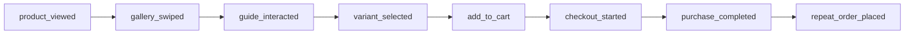
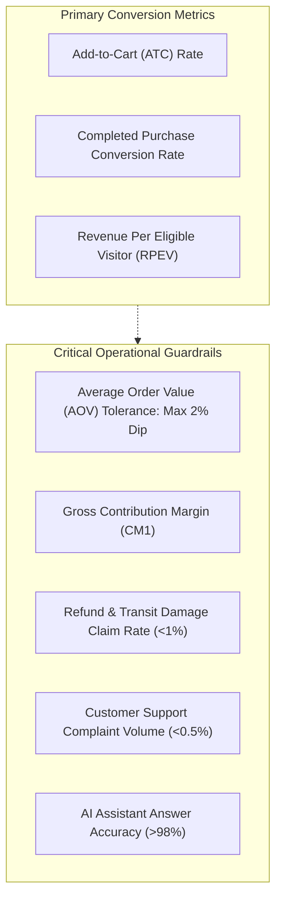

# Implementation & Measurement Plan

**Project:** Wellbeing Nutrition Korean Marine Collagen Peptides CRO Optimisation  
**Author:** Senior Product Manager, Experimentation Analyst & Analytics Lead  
**Date:** October 25, 2026  
**Status:** Approved for Phase 2 Architecture  
**Dedicated Branch:** `feature/collagen-cro-experience`  

---

## 1. Executive Summary

This plan establishes the quantitative measurement infrastructure, event taxonomy, and operational data requests required to support both the upcoming prototype demonstration and eventual production experimentation.

To ensure attribution integrity, every user touchpoint along the 10-stage funnel is instrumented with standardized telemetry, explicit payload definitions, and diagnostic guardrails.

---

## 2. Event Tracking Taxonomy Across the Purchase Funnel

| Funnel Stage | Event Name | Business Purpose | Required Event Payload Fields | Technical & Measurement Caveats |
| :--- | :--- | :--- | :--- | :--- |
| **1. Product View** | `product_viewed` | Track landing traffic baseline and campaign attribution. | `product_id: "7067936915536"`, `sku: "WBNCL"`, `variant_id`, `price: 1745.00`, `currency: "INR"`, `traffic_source`, `device_category` | Deduplicate reload events using sessionStorage session ID. |
| **2. Media Engagement** | `gallery_swiped` | Measure visual exploration of packaging, dissolution, and scoop images. | `media_type: "image"`, `slide_index: 0..4`, `slide_topic: "dissolution_demo"`, `interaction_type: "swipe" \| "thumbnail_click"` | Throttle rapid swipe gestures to prevent event flooding. |
| **3. Review Exploration** | `review_interaction` | Measure depth of social proof evaluation and filter utility. | `action: "filter_applied" \| "search_queried" \| "helpful_voted"`, `filter_category: "mix_coffee" \| "duration_2mo"`, `search_keyword` | Capture null search result states to identify missing review content. |
| **4. AI Assistance** | `guide_interaction` | Evaluate pre-purchase assistant engagement and intent resolution. | `action: "chip_clicked" \| "query_sent" \| "escalation_clicked"`, `query_text`, `intent_matched`, `uncertainty_flag: boolean` | Mask all PII (names, phone numbers, email) before sending to analytics stream. |
| **5. Pack Selection** | `variant_selected` | Track shift from single pack to multi-pack or starter pack. | `variant_name: "Pack of 2"`, `pack_count: 2`, `servings: 50`, `price_inr: 3418.00`, `price_per_serving_inr: 68.36`, `previous_variant` | Fire only when the user deliberately toggles variant, not on page load default. |
| **6. Add to Cart** | `add_to_cart` | Primary top-of-funnel conversion intent metric. | `variant_id`, `quantity: 1`, `value_inr: 1745.00`, `cta_location: "hero_buy_box" \| "sticky_bottom_bar"` | Track whether trigger came from primary hero or sticky mobile tray. |
| **7. Checkout Started** | `checkout_started` | Measure progression to transaction gateway. | `checkout_type: "gokwik_1click" \| "shopify_native"`, `order_value_inr`, `item_count: 1` | GoKwik iframe modal open event must bridge into Google Analytics 4 dataLayer. |
| **8. Purchase Completed** | `purchase_completed` | Core business revenue conversion event. | `order_id`, `gross_revenue_inr`, `net_revenue_inr`, `discount_code_used`, `shipping_fee_inr`, `is_first_time_buyer: boolean` | Reconcile with Shopify server-side webhook to prevent ad-blocker signal loss. |
| **9. Repeat Purchase** | `repeat_order_placed` | Track 30/60/90-day retention and voucher redemption. | `original_order_id`, `new_order_id`, `days_since_first_order`, `voucher_redeemed: boolean`, `cohort_type: "starter" \| "full_size"` | Measured via CRM / Shopify backend analytics pipeline. |

---

## 3. Primary Metrics & Operational Guardrails

### Detailed Guardrail Tolerances:
1. **Average Order Value (AOV):** If Experiment A (price per serving) encourages lower pack sizes, or Experiment C (starter pack) cannibalizes full tubs, AOV must not decline by more than **2.0%** without being offset by a higher conversion volume.
2. **Gross Contribution Margin (CM1):** Multi-pack discounts must maintain a minimum product-level contribution margin of **$\ge 60\%$** after all fulfillment and packaging costs.
3. **Refund & Cancellation Rates:** Must remain below **1.0%** of total shipments. Any spike in post-delivery complaints triggers an immediate audit of product messaging.
4. **Product Guide Accuracy:** Measured weekly via sampling: assistant answers must demonstrate **$\ge 98\%$ grounded accuracy** against approved documentation, with **0% hallucinated medical claims**.

---

## 4. Prioritised Cross-Functional Data-Request Register

The following formal requests are submitted to internal stakeholders to resolve critical unknowns prior to production rollout:

| Priority | Department | Specific Data / Artifact Requested | Business Rationale | Impacted Phase |
| :---: | :--- | :--- | :--- | :---: |
| **P1** | **Analytics** | GA4 & Shopify 90-day funnel export: device breakdown of PDP views, ATC, GoKwik checkout initiated, and completion rates. | Establishes true baseline conversion rates and traffic sample sizes for A/B testing. | Phase 2 / 3 |
| **P1** | **Operations / Quality** | Heavy-metal (mercury, lead, arsenic) certificate of analysis and wild-caught fish species documentation. | Substantiates purity claims and provides verified copy for Product Guide AI. | Phase 2 / 3 |
| **P1** | **Legal & Regulatory** | ASCI compliance review of *"50-day supply (assuming 1 serving/day)"* and *"100% Genuine Seal & Transit Replacement"* wording. | Prevents regulatory notice or marketing dispute under Indian consumer protection rules. | Phase 2 / 3 |
| **P2** | **Finance** | Unit economics schedule for 200g tub vs proposed 112g (14-serving) starter format (COGS, freight, packaging). | Validates whether ₹999 starter pack achieves $\ge 60\%$ contribution margin. | Phase 3 |
| **P2** | **Customer Support** | Top 20 pre-purchase customer ticket categorizations from Zendesk/Freshdesk for marine collagen over the past 6 months. | Fine-tunes the Product Guide AI Agent intent matching and FAQ hierarchy. | Phase 2 / 3 |
| **P3** | **CRM / Retention** | 30-, 60-, and 90-day repurchase cohort curves for first-time Korean Marine Collagen buyers over the last 12 months. | Benchmarks baseline replenishment rates against proposed retention programmes. | Phase 3 |

---

## 5. Prototype Scope vs. Production Implementation Boundaries

To ensure rapid delivery of the upcoming Phase 3 prototype without exceeding architectural boundaries, dependencies are segregated into prototype requirements vs production integrations:

| Functional Area | Phase 3 Prototype Architecture (Local) | Production Rollout Architecture (Future) |
| :--- | :--- | :--- |
| **Storefront Rendering** | Standalone responsive HTML5 / Tailwind / Vanilla JS prototype demonstrating all 11 modules. | Liquid theme components integrated into Shopify Theme 125796089936 (`theme.liquid`). |
| **Product Guide AI Agent** | Local in-memory JSON structured knowledge engine with heuristic keyword & semantic intent matching. Zero external API calls. | Secure backend microservice calling enterprise LLM endpoint with vector store retrieval and logging. |
| **Review Exploration** | Embedded sample dataset of 25 authentic, illustrative reviews covering taste, coffee mix, and star ratings. | Live Judge.me API sync with dynamic filtering and photo review CDN integration. |
| **Variant Pricing Logic** | Client-side reactive JavaScript calculating price per serving and updating UI states in real time. | Shopify AJAX Cart API (`/cart/add.js`, `/cart/change.js`) with dynamic currency formatting. |
| **Checkout Flow** | Simulated checkout modal demonstrating 1-click GoKwik trigger and address entry preview. | Live GoKwik checkout bridge (`wbn2-direct-checkout.js`) with real payment processing. |
| **A/B Test Routing** | URL query parameter toggles (`?variant=control`, `?variant=unit_pricing`) for deterministic stakeholder inspection. | Server-side or edge experimentation engine (e.g. Cloudflare Workers, LaunchDarkly, or VWO). |
