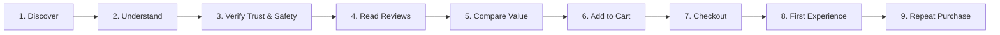

# Customer Purchase & Retention Journey Map

**Product:** Pure Korean Marine Collagen Peptides | Wellbeing Nutrition  
**Author:** Senior Product Manager & CRO Specialist  
**Access Date:** October 25, 2026  
**Dedicated Branch:** `feature/collagen-cro-experience`  

---

## 1. Journey Architecture & Customer Personas

This map outlines the complete cognitive and behavioral journey of prospective and returning buyers for Wellbeing Nutrition's Korean Marine Collagen Peptides. It addresses three primary customer segments:

1. **The First-Time Skeptic (Primary Persona):** Female/male, age 26–45, experiencing early signs of skin dullness, fine lines, or joint stiffness. Hesitant about spending ₹1,745 on an unflavored fish supplement; terrified of a fishy aftertaste, digestive side effects, or zero noticeable outcomes.
2. **The Routine Optimizer (Secondary Persona):** Active wellness consumer who already takes daily supplements (protein, vitamins) and wants the highest-bioavailability collagen for hair and skin. Compares molecular weight (Daltons), sourcing, and cost per day against Nutrova and HK Vitals.
3. **The Repeat / Bundle Buyer:** Satisfied previous customer seeking the best replenishment economics, bulk savings, or subscription convenience without running out mid-cycle.

---

## 2. Nine-Stage Journey Analysis

---

### Stage 1: Discover (Landing on Product Page)
* **Customer's Likely Question:** *"Is this genuine Korean collagen, and is this what I need for my skin and hair?"*
* **Information the Page Provides:** 
  * Header title: `"Pure Korean Marine Collagen Peptides | Unflavored | Combat Signs of Ageing"`.
  * Sub-badge: `"Collagen Peptides with 8g per serving for Skin, Hair, Nails"`.
  * Clean hero lifestyle images featuring Korean marine provenance and minimalist white packaging.
* **Potential Friction:**
  * No immediate statement explaining *why* Korean marine collagen is superior to bovine or local Indian collagen.
  * Absence of a quick self-selection diagnostic ("Is this right for me?").
* **Supporting Evidence:**
  * Hero container inspection (`.product-single__meta`); title focuses on generic anti-aging rather than immediate clinical differentiation.
* **Confidence Level:** High.
* **Validation Requirements:** Analyze Google Analytics / Meta Ads landing bounce rates segmented by creative angle (beauty vs. anti-aging vs. hair).

---

### Stage 2: Understand (Formulation & Routine Fit)
* **Customer's Likely Question:** *"How do I take this? Will it taste fishy, smell bad, or ruin my morning coffee?"*
* **Information the Page Provides:**
  * Mentions unflavored hydrolysate.
  * "How to Enjoy" section states to mix one scoop daily with 250 ml water or beverage.
  * FAQ confirms it can be dissolved in hot coffee or smoothies.
* **Potential Friction:**
  * The unflavored marine taste anxiety is addressed purely in plain text accordions deep down the page.
  * No video or visual demonstration showing the powder dissolving clear and odorless in hot/cold liquids.
* **Supporting Evidence:**
  * "How to Enjoy" text placed in position 8 of the DOM hierarchy; FAQ accordion items 5 and 10 require multiple user taps to reveal.
* **Confidence Level:** High (standard supplement objection confirmed by Baymard Institute usability research).
* **Validation Requirements:** Heatmap analysis (Hotjar/Clarity) of scroll depth to FAQ and usage sections.

---

### Stage 3: Verify Trust & Safety (Efficacy & Sourcing)
* **Customer's Likely Question:** *"Is this safe, certified, heavy-metal tested, and scientifically proven?"*
* **Information the Page Provides:**
  * Mentions pure hydrolyzed marine collagen from deep-sea Korean fish.
  * Displays 4 academic study cards with DOI links to *Journal of Cosmetic Dermatology*, *Journal of Medicinal Food*, and *Orthopedic Reviews*.
  * FSSAI license number (10019022009134) in manufacturer details.
* **Potential Friction:**
  * Academic DOIs lead out of the storefront to technical research papers that ordinary consumers cannot easily understand.
  * Disclaimer text: `*Claims are ingredient-based and not for the product. Images are for illustration purpose only**` creates immediate legalistic doubt.
  * No prominent callout of heavy-metal testing or mercury-free certification, a universal anxiety with marine-derived ingestibles.
* **Supporting Evidence:**
  * External link inspection (`a.abs-link`); text search for "mercury" or "heavy metal" returns zero occurrences.
* **Confidence Level:** High.
* **Validation Requirements:** Review customer support tickets asking about heavy metal testing, pregnancy safety, and vegetarian guidelines.

---

### Stage 4: Read Customer Experiences (Social Proof)
* **Customer's Likely Question:** *"Did real people with my skin type/age see actual changes, or are these reviews fake?"*
* **Information the Page Provides:**
  * Judge.me widget showing `4.74 ★` from 571 reviews.
  * Testimonial section highlighting 4 customer stories with a `"4.9 Review"` banner.
* **Potential Friction:**
  * **Trust-destroying discrepancy:** Rating says 4.74 at the top of the page, but 4.9 in the testimonial block.
  * Reviews lack practical filtering by customer age (e.g., 20s vs. 40s+), main goal (fine lines vs. hair growth), or beverage mix method.
  * Minimal visible authentic user photos/videos of the actual dissolved drink.
* **Supporting Evidence:**
  * Verifiable DOM elements: Judge.me aggregate rating container vs `.testimonial-section` heading.
* **Confidence Level:** High.
* **Validation Requirements:** Track click-through rates on review pagination and review filter interactions.

---

### Stage 5: Compare Value (Packs & Sizing)
* **Customer's Likely Question:** *"How long will this tub last me, and what is the best deal?"*
* **Information the Page Provides:**
  * Variant buttons: Pack of 1 (₹1,745, save 3%), Pack of 2 (₹3,418, save 5%), Pack of 3 (₹5,019, save 7%), Pack of 4 (₹6,476, save 10%).
  * Tub weight: 200g. Serving size: 8g.
* **Potential Friction:**
  * **The 25-Day Supply Trap:** 200g / 8g = 25 servings. The customer is forced to do mental arithmetic to realize a tub lasts only 25 days—falling short of the 4-week (28-day) minimum required to evaluate results!
  * **Missing Cost Anchor:** Without a `₹69.80 / day` label, ₹1,745 feels like a large discretionary expense.
  * **Weak Multi-Pack Incentives:** Saving only 5% on 2 tubs fails to convince first-timers to buy a 50-day course.
* **Supporting Evidence:**
  * `.variant-picker` text and Shopify variant JSON pricing structure.
* **Confidence Level:** High.
* **Validation Requirements:** A/B test variant selector displaying "Cost Per Day" and "Recommended 50-Day Clinical Course".

---

### Stage 6: Add to Cart (Commitment & Thresholds)
* **Customer's Likely Question:** *"Can I return this if it gives me acne or tastes bad? What if it arrives damaged?"*
* **Information the Page Provides:**
  * "Add to Cart" and "Buy Now" buttons.
  * Snapmint 3-month EMI callout.
* **Potential Friction:**
  * Zero above-the-fold transparency regarding return/hygiene restrictions.
  * Customers unaware that supplements cannot be returned once opened feel post-purchase anxiety or hesitate at the final click.
* **Supporting Evidence:**
  * Buy box inspection; `/pages/refunds-cancellation` requires navigating to footer links.
* **Confidence Level:** High.
* **Validation Requirements:** Cart abandonment exit survey asking: *"What prevented you from completing your purchase today?"*

---

### Stage 7: Checkout (Frictionless Payment)
* **Customer's Likely Question:** *"Is checkout quick, secure, and will shipping be free?"*
* **Information the Page Provides:**
  * Direct GoKwik checkout integration (`wbn2-direct-checkout.js`) with OTP login and saved addresses.
  * Snapmint cardless EMI option.
* **Potential Friction:**
  * Surprise shipping charges or unexpected coupon code failures if minimum cart value isn't clearly stated.
* **Supporting Evidence:**
  * Verified GoKwik script integration in HTML source.
* **Confidence Level:** Medium (GoKwik is an established high-converting checkout layer in India).
* **Validation Requirements:** Checkout funnel telemetry from GoKwik dashboard.

---

### Stage 8: First Product Experience (Delivery & First Scoop)
* **Customer's Likely Question:** *"Did I mix this correctly? Why is there foam? When should I take my next dose?"*
* **Information Provided (Physical Packaging):**
  * Back-of-pack instructions: mix 1 scoop with 250ml water.
* **Potential Friction:**
  * If the user mixes with freezing cold water, collagen peptides can clump, creating an unpalatable sensory experience that ruins repeat purchase likelihood.
  * No post-purchase email onboarding or QR code on the lid linking to "Best Ways to Drink Your Collagen".
* **Supporting Evidence:**
  * Packaging back-of-pack image analysis (`BOP_2_62e7373d...jpg`).
* **Confidence Level:** Medium.
* **Validation Requirements:** Customer retention surveys at Day 7 post-delivery.

---

### Stage 9: Repeat Purchase (Replenishment & Retention)
* **Customer's Likely Question:** *"My tub is empty after 25 days. Has my skin improved enough to justify spending another ₹1,745?"*
* **Information Provided:**
  * Email / SMS replenishment reminders (assumed standard D2C CRM flow).
* **Potential Friction:**
  * Because 1 tub lasts only 25 days, the customer's tub runs out *before* noticeable skin improvements peak at 6–8 weeks.
  * Without an automated subscription model or a built-in repeat-purchase credit, reorder friction is high.
* **Supporting Evidence:**
  * Absence of a recurring subscription widget on the live Shopify product page.
* **Confidence Level:** High.
* **Validation Requirements:** 30/60/90-day repeat order cohort curves from Shopify / Klaviyo CRM data.

---

## 3. Journey Friction Summary & Strategic Intervention Mapping

| Journey Stage | Primary Friction Identified | Proposed Phase CRO Intervention |
| :--- | :--- | :--- |
| **Understand** | Sensory fear of fishy taste and clumping | **Intervention 1:** Sensory Reassurance & Rapid Mixability Module |
| **Compare Value** | Price sticker shock & 25-day supply gap | **Intervention 2:** Price-per-serving breakdown & 50-day "Clinical Course" bundle |
| **Verify Trust** | Rating mismatch & academic jargon | **Intervention 3:** Unified 4.74★ social proof & visual "Evidence at a Glance" cards |
| **Add to Cart** | High financial commitment for first-timers | **Intervention 4:** 14-serving low-commitment Starter Pack option |
| **Decision Support**| Unanswered lifestyle/dietary questions | **Intervention 5:** Interactive Collagen Routine & Suitability Assistant |
