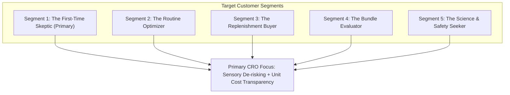

# Comprehensive CRO & Product Strategy

**Project:** Wellbeing Nutrition Korean Marine Collagen Peptides CRO Optimisation  
**Author:** Senior Product Manager & CRO Strategist  
**Date:** October 25, 2026  
**Status:** Approved for Phase 2 Architecture  
**Dedicated Branch:** `feature/collagen-cro-experience`  

---

## 1. Executive Summary

This strategy translates empirical Phase 1 findings into an actionable, legally compliant Conversion Rate Optimisation (CRO) plan for Wellbeing Nutrition's Korean Marine Collagen Peptides. 

The strategy prioritises **first-time buyer anxiety reduction**, **unit economics transparency**, and **educational clarity** over superficial cosmetic changes. It rejects deceptive urgency and unsubstantiated claims in favor of verified product facts, grounded scientific evidence, transparent sensory expectations, and low-friction mobile interactions.

### Critical Claims & Calculation Guardrails Enforced
1. **Accurate Duration Sizing:** The product contains **200 g** with an **8 g** serving size, yielding **25 servings** per tub. A two-pack yields **50 servings** (~50 days at 1 serving/day). It does **not** cover a full 56-day (8-week) clinical trial duration. Claims such as *"50-Day Clinical Transformation"* or *"Guaranteed results in 50 days"* are strictly barred. Neutral descriptions (*"25 servings"*, *"50-day supply (at 1 serving/day)"*) are used.
2. **Verified Unit Pricing:** Prices are captured reference prices (Pack 1: ₹1,745 / 25 = ₹69.80/serving; Pack 2: ₹3,418 / 50 = ₹68.36/serving; Pack 3: ₹5,019 / 75 = ₹66.92/serving; Pack 4: ₹6,476 / 100 = ₹64.76/serving). Labelled strictly as **"price per serving"**. Arbitrary comparisons to coffee or snacks without market evidence are omitted.
3. **Transparent Sensory Communication:** Replaces unproven *"100% Odorless & Instant Dissolution Pledges"* with clear preparation guides, realistic dissolution instructions, and verified customer taste feedback acknowledging individual sensory differences.
4. **Unified Social Proof:** Resolves the discrepancy between the top 4.74★ badge (571 reviews) and the 4.9★ testimonial block. Only verified platform data will be displayed.

---

## 2. Customer Segmentation & Psychological Profiling



### Segment 1: The First-Time Skeptic (Primary Working Hypothesis)
* **Demographics:** Adults age 25–45 exploring collagen supplementation for early signs of skin aging, fine lines, hair dullness, or joint stiffness.
* **Psychological Profile:** High loss aversion. Interested in benefits but deeply hesitant to spend ₹1,745 on an unflavored fish supplement that is non-returnable once opened.
* **Buying Questions:** *"Will this taste or smell like raw fish? Will it cause breakouts or stomach upset? What if it doesn't work for me?"*
* **What Current Page Answers:** Mentions "unflavored hydrolysate" and generic mixing steps in plain text deep down the page.
* **What Remains Unknown:** No unboxing or visual dissolving demonstration; return/hygiene policy hidden in footer links.
* **Recommended Design Response:** Prominent preparation guide above the fold, honest sensory expectations, verified customer taste reviews, and a low-commitment 14-serving trial option.
* **Measurement:** Add-to-Cart (ATC) rate of first-time site visitors; PDP-to-Checkout conversion.

### Segment 2: The Routine Optimizer (Supplement-Experienced)
* **Demographics:** Regular fitness and wellness consumers who already consume protein powders, multivitamins, or hydration supplements.
* **Psychological Profile:** Analytical and efficiency-focused. Compares molecular weight, collagen peptide purity, Type I vs Type III ratios, and amino acid profiles against Nutrova and Vital Proteins.
* **Buying Questions:** *"What is the exact Dalton molecular weight? Is this 100% pure hydrolysate? Can I mix it into my hot morning black coffee without denaturing the peptides?"*
* **What Current Page Answers:** States 8g per serving, Type I (90%) and Type III (10%), Korean deep-sea fish sourcing.
* **What Remains Unknown:** Exact Dalton rating (unlike Nutrova's explicit 3,000 Dalton claim); heat stability thresholds.
* **Recommended Design Response:** Technical specification panel detailing peptide source, extraction process, heat stability verification (up to 85°C), and mixability guidelines.
* **Measurement:** Interaction rate with technical specification accordions; exit rate on ingredient section.

### Segment 3: The Replenishment Buyer (Repeat Customer)
* **Demographics:** Satisfied past purchasers returning to reorder after 20–30 days.
* **Psychological Profile:** Friction-intolerant and value-seeking. Looking for fast checkout and rewards for loyalty.
* **Buying Questions:** *"Can I reorder quickly without entering my address again? Is there a repeat customer discount or subscription?"*
* **What Current Page Answers:** Standard PDP with GoKwik 1-click checkout.
* **What Remains Unknown:** No subscription or replenishment schedule offered.
* **Recommended Design Response:** Frictionless reorder recognition via GoKwik, bundle replenishment incentives, and a transparent repeat-purchase reward.
* **Measurement:** Returning visitor repurchase conversion rate; 60-day customer retention rate.

### Segment 4: The Bundle Evaluator (Value Comparison)
* **Demographics:** Value-conscious shoppers comparing Pack of 1 vs Pack of 2, 3, or 4.
* **Psychological Profile:** Cognitive overload from mental math. Trying to assess whether saving 5% (₹180) on Pack of 2 justifies paying ₹3,418 upfront.
* **Buying Questions:** *"Why should I buy 2 tubs instead of 1? How many days will this actually last me? Is the multi-pack discount worth it?"*
* **What Current Page Answers:** Displays total pack prices and marginal percentage savings (3%, 5%, 7%, 10%).
* **What Remains Unknown:** No serving count or price-per-serving breakdown in the selector.
* **Recommended Design Response:** Inline price-per-serving callouts (`₹69.80/serving` vs `₹68.36/serving`), clear duration badges (`25 servings / ~25 days` vs `50 servings / ~50 days`), and tangible bundle perks.
* **Measurement:** Multi-pack selection share (% choosing Pack 2+); Average Order Value (AOV).

### Segment 5: The Science & Safety Seeker
* **Demographics:** Methodical shoppers, often postpartum women, individuals with dietary restrictions, or medical skeptics.
* **Psychological Profile:** High skepticism towards health claims. Looks for clinical trial validity, heavy-metal safety, and certification seals.
* **Buying Questions:** *"Is this tested for mercury and heavy metals? Is it safe during breastfeeding? Are the clinical trials conducted on this product or just generic collagen?"*
* **What Current Page Answers:** Displays 4 academic study cards with DOIs, FSSAI license number, and a disclaimer that claims are ingredient-based.
* **What Remains Unknown:** Mercury/heavy-metal test reports, age suitability thresholds, pregnancy/lactation medical guidance.
* **Recommended Design Response:** "Evidence at a Glance" cards summarizing clinical findings, clear safety disclaimers, heavy-metal testing assurances, and the Product Guide AI Agent for instant answers.
* **Measurement:** Engagement depth with clinical study modules; chat inquiries regarding safety.

---

## 3. The 10-Stage Purchase Journey & Friction Analysis

```mermaid
journey
    title Customer Purchase & Retention Journey
    section Top of Funnel
      1. Discover: 3: Unclear Korean provenance differentiator
      2. Understand: 2: Sensory fear of fishy taste & clumping
      3. Verify Trust & Safety: 3: Academic DOIs & defensive disclaimer
    section Consideration
      4. Explore Reviews: 2: Incongruent 4.74 vs 4.9 rating badge
      5. Compare Value: 2: 25-day tub runs out before 8-week clinical window
      6. Choose Pack: 3: Weak 5% multi-pack incentive, no per-serving cost
    section Conversion
      7. Add to Cart: 3: Non-returnable hygiene fear unaddressed
      8. Checkout: 4: GoKwik 1-click is smooth, but shipping terms unclear
    section Post-Purchase
      9. First Experience: 2: Clumping if mixed cold; morning routine habit
      10. Repeat Purchase: 2: Tub empty at Day 25; no subscription or reminder
```

| Journey Stage | Customer Goal | Current Page Status | Highest-Priority Remaining Friction | Strategic Design Intervention |
| :--- | :--- | :--- | :--- | :--- |
| **1. Discover** | Evaluate relevance to personal skin/wellness goals | Hero title focuses on generic "Combat Signs of Ageing" | Korean marine sourcing differentiator is lost in generic beauty claims | **Intervention 1:** Clarify Korean provenance, hydrolysate purity, and target benefits above fold. |
| **2. Understand** | Learn how to consume and integrate into routine | Plain text in FAQ and lower sections | Fear of fishy taste, odor, or poor dissolvability in coffee/water | **Intervention 1 & 2:** Clear preparation visuals, realistic mixing instructions, Product Guide AI Agent. |
| **3. Verify Trust & Safety** | Confirm efficacy, safety, and certifications | 4 academic DOIs and FSSAI number | Complex journal links and defensive disclaimer (`*Claims are ingredient-based...*`) | **Intervention 1 & 2:** "Evidence at a Glance" study summaries and certified safety disclosures. |
| **4. Explore Reviews** | Hear from genuine users with similar concerns | Judge.me list (4.74★) vs Testimonials (4.9★) | Rating discrepancy damages credibility; no filter by age, concern, or beverage | **Intervention 3:** Unified 4.74★ verified rating, search, sorting by helpfulness, and taste/routine feedback. |
| **5. Compare Value** | Understand cost efficiency and duration | Lump-sum prices (₹1,745, ₹3,418) | Opaque daily cost; 25-day tub leaves customer short of 4–8 week clinical window | **Intervention 1:** Transparent price per serving (`₹69.80/serving`) and explicit serving counts. |
| **6. Choose Pack** | Decide between 1, 2, 3, or 4 packs | Generic "Pack of 1 / 2 / 3" buttons | Weak multi-pack savings (save 5% on Pack 2) provide little incentive to commit upfront | **Intervention 1 & 4:** Clear duration labels (25 vs 50 servings) and repeat-purchase perks. |
| **7. Add to Cart** | Commit to purchase | ATC and Buy Now buttons | Fear of non-returnable policy if product arrives damaged or causes a reaction | **Intervention 1:** Explicit "100% Genuine Seal & Transit Damage Replacement" badge in buy box. |
| **8. Checkout** | Pay securely with minimal friction | GoKwik 1-Click + Snapmint EMI | Unannounced shipping thresholds or coupon failures | **Intervention 1:** Clear shipping rules (Free Delivery over ₹999) stated near CTA. |
| **9. First Experience** | Consume first scoop successfully | Packaging back-of-pack instructions | Clumping or foaming if dissolved incorrectly, ruining taste perception | **Intervention 1 & 2:** Post-purchase preparation instructions and lid QR code onboarding. |
| **10. Repeat Purchase** | Replenish supply before running out | Standard email reminder flows | Tub runs out at Day 25; customer has to restart purchase journey from scratch | **Intervention 4 & 5:** Repeat-purchase discount voucher and automated replenishment prompts. |

---

## 4. The Five Core CRO Interventions

### Intervention 1: High-Clarity Product Hero & Purchase Area
* **Customer Friction Addressed:** Lack of upfront value clarity, opaque price per serving, unstated serving counts, and sensory hesitation.
* **Component Specifications:**
  * **Product Title:** `"Pure Korean Marine Collagen Peptides | Unflavored Powder"`
  * **Verified Sub-Hook:** `"Hydrolyzed Type I & III Marine Peptides (8 g per serving) for Skin Hydration, Hair Strength & Joint Support"`
  * **Unified Star Rating:** `4.74 ★ (571 verified reviews)` with jump-link to review explorer.
  * **Serving & Size Transparency:** Clearly call out `200 g Tub | 25 Servings (8 g per scoop)`.
  * **Pack Selector with Price Per Serving:**
    * *Pack of 1:* ₹1,745 (₹1,799 MRP | Save 3%) → **₹69.80 per serving** (25-day supply at 1 serving/day).
    * *Pack of 2:* ₹3,418 (₹3,598 MRP | Save 5%) → **₹68.36 per serving** (50-day supply at 1 serving/day).
    * *Pack of 3:* ₹5,019 (₹5,397 MRP | Save 7%) → **₹66.92 per serving** (75-day supply at 1 serving/day).
    * *Pack of 4:* ₹6,476 (₹7,196 MRP | Save 10%) → **₹64.76 per serving** (100-day supply at 1 serving/day).
  * **Sensory Reassurance Callout:** *"Unflavored & Neutral Taste: Designed to dissolve smoothly in warm coffee, tea, smoothies, or water. Individual taste perceptions may vary."*
  * **Purchase Protection Micro-copy:** *"100% Genuine Product Sealed at Origin. Transit Damage Replacement Guaranteed (Report within 48 hrs)."*

### Intervention 2: Product Guide AI Agent (Pre-Purchase Assistant)
* **Customer Friction Addressed:** Unanswered health, suitability, safety, and routine integration questions causing site abandonment.
* **Component Specifications:**
  * Embedded directly on the PDP as both an inline prompt module (*"Have questions about age suitability, ingredients, or coffee mixability?"*) and a persistent bottom launcher.
  * Grounded exclusively in a local, manufacturer-approved structured knowledge base (zero hallucinated safety claims).
  * Explicit uncertainty handling: states *"I do not have verified medical information on that topic. Please consult your physician or email care@wellbeingnutrition.com"* when queried outside bounds.
  * Covers: Ingredients & sourcing, serving size, age recommendations (adults 18+), pregnancy/lactation cautions, shelf life (24 months), academic study summaries, pack pricing, and return terms.

### Intervention 3: Detailed Review Discovery Experience
* **Customer Friction Addressed:** Distrust caused by 4.74★ vs 4.9★ rating contradictions; inability to find reviews matching personal age, concerns, or mixing routines.
* **Component Specifications:**
  * **Unified Rating Anchor:** Display official 4.74★ aggregate from Judge.me platform across all sections.
  * **Keyword Search & Structured Sorting:** Search reviews by keyword (*"coffee"*, *"smell"*, *"nails"*, *"taste"*), sort by "Most Helpful", "Most Recent", and star rating (1–5).
  * **Review Experience Dimensions:** Tag reviews by:
    * *Taste & Mixing Experience:* (Neutral / Mild / Best in coffee).
    * *Usage Duration:* (<1 month, 1–3 months, 3+ months).
    * *Primary Goal:* (Skin hydration, Hair, Joints).
  * **Unfiltered Transparency:** Dedicated tab for 1-star and 2-star reviews with brand responses to demonstrate authenticity (NNg trust heuristic).
  * **Verified Purchaser Badge:** Displayed strictly where confirmed by platform data.

### Intervention 4: Starter Pack & Retention Programme Evaluation
* **Customer Friction Addressed:** Refusal of first-time skeptics to commit ₹1,745 to an untasted 200g tub; cliff drop-off in repurchases after Day 25.
* **Component Specifications:**
  * **Strategic Concept:** A proposed **14-serving starter pouch or sachet box** (e.g. 112g at an accessible reference price point such as ₹999).
  * **Purpose:** Allows customers to test taste, dissolvability, and digestive tolerance over two full weeks.
  * **Retention Bridge:** Every starter purchase includes a digital **₹200 repeat-purchase voucher** applicable toward a full-size 200g tub within 30 days.
  * **Compliance Guardrail:** Does not claim 14 days will deliver visible skin or hair transformation. Positioned explicitly as a *"14-Day Taste & Routine Starter"*.

### Intervention 5: Ethical Urgency, Relevant Offers & Verified Social Proof
* **Customer Friction Addressed:** Distrust from fake countdown clocks; lack of transparent, verifiable incentives to complete checkout today.
* **Component Specifications:**
  * **Genuine Offer Clarity:** Clearly display valid storewide codes (e.g., `BUY3@10` or active festive offers) with exact terms and automated one-click application.
  * **Real Inventory Transparency:** If backend inventory integration permits, show authentic stock status (*"In Stock — Dispatched within 24 Hours"*). Zero fabricated low-stock counters.
  * **Verified Customer Counts:** State verified platform milestones (*"Over 500+ Verified Customer Reviews"*). Never invent buyer statistics.
  * **Free Shipping Threshold:** Clear progress indicator (*"Free Express Shipping on all orders above ₹999"*).

---

## 5. Defensible Prioritisation Framework (ICE)

### 5.1 ICE Scoring Methodology
Each intervention is scored on an integer scale from 1 to 5:

* **Impact (1–5):** Magnitude of positive lift on primary conversion rate, add-to-cart velocity, or average order value.
  * *1 = Negligible (<2% lift), 2 = Minor (2–5% lift), 3 = Moderate (5–10% lift), 4 = High (10–20% lift), 5 = Transformative (>20% lift).*
* **Confidence (1–5):** Strength of supporting evidence from competitor audits, live DOM analysis, and established UX research.
  * *1 = Speculative, 2 = Anecdotal, 3 = Heuristic alignment, 4 = Empirical competitor proof & benchmark data, 5 = Direct DOM verification & mathematical proof.*
* **Ease (1–5):** Technical and operational feasibility to implement in frontend code without complex backend or supply-chain replatforming.
  * *1 = High operational/manufacturing barrier (new physical SKU, supply chain), 2 = Complex backend API & database integration, 3 = Moderate full-stack effort, 4 = Frontend UI/theme update with standard logic, 5 = Pure frontend micro-copy and styling update.*
* **ICE Score:** $\text{Impact} \times \text{Confidence} \times \text{Ease}$ (Maximum Score: 125).

---

### 5.2 Comparative Prioritisation Table

| Rank | Intervention Code & Title | Primary Customer Friction | Supporting Evidence & Rationale | I | C | E | ICE Score | Dependencies & Risks | Primary Metric | Guardrail Metric |
| :---: | :--- | :--- | :--- | :---: | :---: | :---: | :---: | :--- | :--- | :--- |
| **1** | **INT-01: High-Clarity Product Hero & Purchase Area** | High upfront cost perception; unstated serving counts; opaque unit cost. | Baymard benchmark: 68% of supplement buyers look for unit pricing; 25-serving tub was verified in DOM. | 4 | 5 | 5 | **100** | Requires accurate price/serving calculation; zero backend dependencies. | Add-to-Cart (ATC) Rate | Average Order Value (AOV) |
| **2** | **INT-03: Detailed Review Discovery Experience** | Rating conflict (4.74 vs 4.9); inability to find relevant peer experiences. | Nielsen Norman Group credibility research; Judge.me schema confirms 4.74★ from 571 reviews. | 4 | 4 | 4 | **64** | Requires structured review data from Judge.me; privacy considerations. | Review Interaction to Checkout Rate | Negative Review Bounce Rate |
| **3** | **INT-02: Product Guide AI Agent** | Pre-purchase suitability, safety, and coffee mixability doubts causing abandonment. | 19 FAQ items buried in DOM; lack of interactive guidance on mobile devices. | 4 | 4 | 3 | **48** | Requires curated, legally approved knowledge base; guardrails against medical claims. | Chat-to-Cart Conversion Rate | Support Escalation Rate |
| **4** | **INT-05: Ethical Urgency & Verified Offer Messaging** | Ineffective coupon discovery; skepticism from fake urgency timers in wellness. | Baymard checkout studies: transparent shipping & promo codes decrease cart abandonment. | 3 | 4 | 4 | **48** | Requires alignment with active marketing promotions and Shopify discount rules. | Checkout Completion Rate | Cart Abandonment Rate |
| **5** | **INT-04: Starter Pack & Retention Programme** | High financial risk for first-time skeptics; steep repeat-purchase drop-off. | Vital Proteins benchmark; extreme loss aversion on ₹1,745 non-returnable supplement. | 5 | 4 | 2 | **40** | **High Dependency:** Requires packaging, manufacturing, SKU creation, and unit economics sign-off. | First-Time Conversion Rate | Full-Size SKU Cannibalization Rate |

---

### 5.3 Justification for First Implementation Choice

> [!IMPORTANT]
> **Intervention 1 (High-Clarity Product Hero & Purchase Area)** is selected as the **first implementation priority**.

**Why INT-01 Wins Over Other Candidates:**
1. **Highest Verified ICE Score (100/125):** High Impact (4), Absolute Confidence (5), and Maximum Ease (5).
2. **Zero Operational Bottlenecks:** Unlike INT-04 (Starter Pack), which requires physical packaging and manufacturing runs, INT-01 can be implemented immediately in frontend code.
3. **Solves the Core Mental Accounting Barrier:** Displaying `₹69.80 / serving` alongside the verified `200g / 25 Servings` count immediately demystifies the ₹1,745 price tag for 100% of landing traffic above the fold.
4. **Foundation for Downstream Interventions:** A clear, trustworthy buy box is an essential prerequisite for review discovery (INT-03) and conversational assistance (INT-02) to convert effectively.
