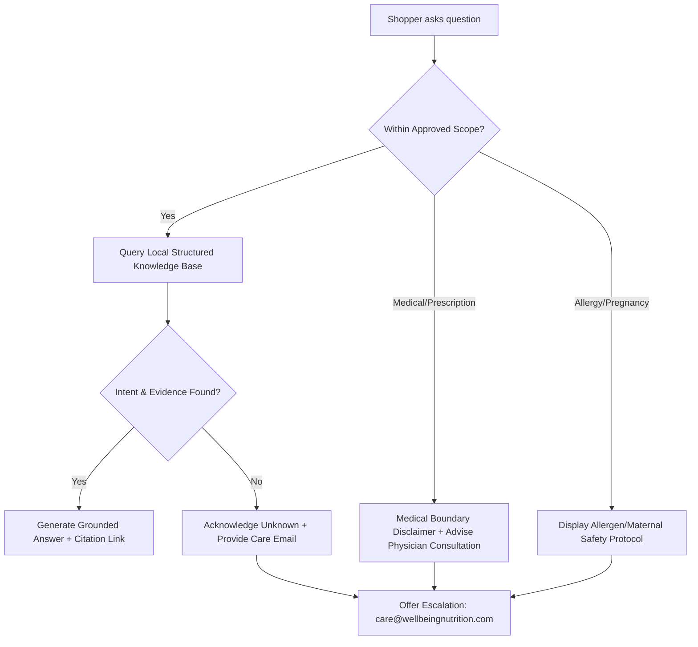

# Product Guide AI Agent Specification

**Project:** Wellbeing Nutrition Korean Marine Collagen Peptides CRO Optimisation  
**Author:** Senior Product Manager & Conversational UX Architect  
**Date:** October 25, 2026  
**Status:** Approved for Phase 2 Architecture  
**Dedicated Branch:** `feature/collagen-cro-experience`  

---

## 1. System Mission & Core Operating Philosophy

The **Product Guide AI Agent** is an automated pre-purchase assistant embedded directly into the Korean Marine Collagen Peptides product page. Its primary goal is to **resolve customer hesitation** regarding product suitability, ingredients, preparation, taste, scientific evidence, pricing, and return terms in real time.



### Absolute Guardrails:
1. **Local, Grounded Knowledge Source:** In the prototype architecture, the assistant operates over an approved, local JSON/Markdown knowledge structure. It has zero external web scraping access and will not hallucinate facts.
2. **Zero Medical Diagnoses:** The agent must never diagnose diseases, recommend treatment regimens for medical conditions (e.g. osteoarthritis, autoimmune disorders), or claim universal safety.
3. **Transparent Uncertainty Handling:** When queried on data outside its verified domain (e.g. unstated clinical trials, specific batch expiry dates, unapproved competitive claims), the agent must explicitly state: *"I do not have verified documentation on that topic."*
4. **No Exaggerated Superiority Claims:** It will not disparage competitors or claim Wellbeing Nutrition is "10x better" without cited third-party verification.
5. **Mandatory Allergen & Safety Flags:** Queries mentioning fish, shellfish, pregnancy, lactation, or prescription medication trigger mandatory caution protocols.

---

## 2. Structured Knowledge Schema (Local Grounded Store)

For the prototype implementation, the agent queries the following structured knowledge domains:

```json
{
  "product_metadata": {
    "name": "Pure Korean Marine Collagen Peptides",
    "flavor": "Unflavored",
    "weight_grams": 200,
    "serving_size_grams": 8,
    "servings_per_container": 25,
    "mrp_inr": 1799.00,
    "price_inr": 1745.00,
    "price_per_serving_inr": 69.80,
    "fssai_license": "10019022009134",
    "shelf_life_months": 24,
    "country_of_origin": "India (Marine Collagen Peptides imported from Korea)",
    "dietary_type": "Non-Vegetarian (Marine Fish)"
  },
  "pricing_tiers": [
    { "pack": 1, "servings": 25, "price_inr": 1745, "price_per_serving_inr": 69.80, "savings_pct": 3 },
    { "pack": 2, "servings": 50, "price_inr": 3418, "price_per_serving_inr": 68.36, "savings_pct": 5 },
    { "pack": 3, "servings": 75, "price_inr": 5019, "price_per_serving_inr": 66.92, "savings_pct": 7 },
    { "pack": 4, "servings": 100, "price_inr": 6476, "price_per_serving_inr": 64.76, "savings_pct": 10 }
  ],
  "formulation": {
    "collagen_type": "90% Type I, 10% Type III Hydrolyzed Collagen Peptides",
    "source": "Wild-caught Korean deep-sea fish skin/scales",
    "additives": "Zero added sugar, zero artificial sweeteners, zero preservatives, gluten-free, dairy-free",
    "molecular_weight": "Low molecular weight hydrolysate (exact Dalton certification awaiting laboratory confirmation)"
  },
  "usage": {
    "serving_instructions": "Mix 1 level scoop (8 g) daily with 200–250 ml of room-temperature water, morning coffee, tea, or smoothie.",
    "timing": "Can be consumed at any time of day; mid-morning or evening routines are commonly preferred by users.",
    "heat_stability": "Hydrolyzed collagen peptides remain stable in warm coffee and tea (up to 85°C)."
  },
  "return_and_cancellation_policy": {
    "cancellation": "Orders may be cancelled free of charge prior to warehouse dispatch by emailing care@wellbeingnutrition.com.",
    "returns": "Due to hygiene and food safety regulations, supplements are strictly non-returnable once the protective seal is broken or product is opened.",
    "damaged_goods": "Damaged in transit or defective products are replaced free of charge when reported within 48 hours of delivery with photographic evidence."
  }
}
```

---

## 3. Conversational Intent Architecture & Answer Requirements

### Intent 1: Ingredients & Sourcing
* **Trigger Queries:** *"Where is this from?", "What fish is used?", "Is this pure collagen?"*
* **Approved Response Requirement:** Must state pure Type I (90%) and Type III (10%) marine collagen peptides sourced from deep-sea fish in South Korea. Must state zero added sugar, artificial flavors, gluten, or dairy.
* **Citation:** Packaging specifications and official manufacturer FSSAI disclosures.

### Intent 2: Preparation, Taste & Coffee Mixability
* **Trigger Queries:** *"Does it taste fishy?", "Can I put it in hot coffee?", "How do I take it?"*
* **Approved Response Requirement:** State that it is formulated as an unflavored, neutral powder designed to mix seamlessly into warm coffee, tea, water, or smoothies. Transparently note that when mixed into plain water, sensitive palates may detect a faint natural mineral note. Recommend stirring for 20–30 seconds.
* **Citation:** Official preparation guide and verified customer usage feedback.

### Intent 3: Age Suitability & Demographics
* **Trigger Queries:** *"Can a 20-year-old take this?", "Is this for men too?", "Can teenagers take it?"*
* **Approved Response Requirement:** State that natural bodily collagen synthesis begins declining in one's mid-20s. Formulated for adult women and men (18+). Recommend that individuals under 18 consult a pediatric nutritionist.
* **Citation:** FSSAI adult dietary supplement classification.

### Intent 4: Allergens, Side Effects & Medical Cautions
* **Trigger Queries:** *"I'm allergic to seafood", "Can I take this while pregnant?", "Will it break me out?"*
* **Approved Response Requirement:**  
  * *Fish Allergy:* Absolute contraindication. State clearly: *"Contains fish. Do not consume if you have fish or marine allergies."*
  * *Pregnancy/Lactation:* *"Please consult your obstetrician or healthcare professional before taking collagen supplements during pregnancy or nursing."*
  * *Acne/Digestion:* Collagen peptides are generally well-tolerated proteins, but individual digestive sensitivities can occur. Advise starting with half a scoop (4 g) if sensitive.
* **Citation:** Mandatory allergen advisory standards.

### Intent 5: Scientific Evidence & Expected Timelines
* **Trigger Queries:** *"Does collagen really work?", "When will I see results?", "Is there clinical proof?"*
* **Approved Response Requirement:** Clarify that clinical trials on oral hydrolyzed collagen peptides in dermatology journals have evaluated skin hydration, elasticity, and fine lines over **4 to 8 weeks of daily use**. Avoid promising "instant" or "guaranteed" outcomes. Explicitly note that individual results vary depending on age, lifestyle, and routine consistency.
* **Citation:** *Journal of Cosmetic Dermatology* (2015, 2021) and *Journal of Medicinal Food* (2022).

### Intent 6: Pricing, Pack Options & Price Per Serving
* **Trigger Queries:** *"Which pack should I buy?", "How much per day?", "Do you have discounts?"*
* **Approved Response Requirement:** Detail the exact price per serving: Pack 1 = ₹69.80/serving (25 servings), Pack 2 = ₹68.36/serving (50 servings). Highlight that Pack 2 provides 50 servings, which covers approximately 7 weeks at 1 scoop per day. Reference active storewide promotions (e.g. `BUY3@10`).
* **Citation:** Storefront pricing schedule.

### Intent 7: Return, Replacement & Cancellation Terms
* **Trigger Queries:** *"Can I return this if I don't like it?", "What if my jar arrives broken?"*
* **Approved Response Requirement:** Transparently state that opened dietary supplements cannot be returned for hygiene reasons. Reassure the customer that transit damage or defective packaging is covered by a 100% free replacement guarantee when reported within 48 hours to `care@wellbeingnutrition.com`.
* **Citation:** Official Wellbeing Nutrition Refund Policy.

---

## 4. Uncertainty Handling & Safe Failure Modes

When the agent cannot match an approved intent or verify a fact with high confidence, it executes the **Three-Step Safe Fallback Protocol**:

```markdown
1. **Acknowledge the Data Gap:**
   "I don't have verified information from Wellbeing Nutrition regarding [specific topic/ingredient/batch date]."

2. **Provide the Closest Verified Boundary:**
   "What I can confirm is that this product contains pure hydrolyzed Type I and III marine peptides with zero added sugar or fillers."

3. **Offer Human Escalation:**
   "For personalized inquiries or medical documentation, please reach out directly to our customer care team at care@wellbeingnutrition.com or WhatsApp support."
```

---

## 5. UI/UX Architecture & Responsive Presentation

### Desktop Presentation
* Embedded inline above the fold as a sleek, 2-column card: *"Product Suitability & Routine Guide — Ask anything about ingredients, coffee mixability, or safety."*
* Includes 4 clickable starter chips (`"Coffee mixability?"`, `"Seafood allergy?"`, `"How many days per pack?"`, `"Can I return it?"`).
* Displays a compact conversational drawer that expands smoothly on interaction without navigating away from the purchase controls.

### Mobile Presentation
* Persistent floating action pill at bottom-right of viewport: `💬 Ask Product Guide`.
* Tapping expands a native bottom sheet (drawer) covering 75% of the mobile viewport, with full keyboard accessibility and instant tap-to-dismiss.
* Maintains high visual contrast and minimum 44px touch targets for all prompt chips.

---

## 6. Audit Trail & Verification Telemetry

To monitor safety, response accuracy, and CRO impact in production, the agent must log the following event telemetry:
* `guide_opened`: User expanded assistant (entry source: hero chip vs floating pill).
* `guide_query_submitted`: Verbatim user question text.
* `guide_intent_matched`: ID of matched knowledge intent (e.g. `intent_coffee_mixability`).
* `guide_fallback_triggered`: Flagged when query falls outside knowledge boundaries.
* `guide_escalation_clicked`: User clicked `care@wellbeingnutrition.com` mailto or WhatsApp link.
* `guide_to_cart_converted`: User added to cart within 15 minutes of interacting with the guide.
