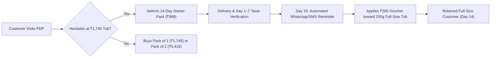

# Starter Pack Feasibility & Customer Retention Strategy

**Project:** Wellbeing Nutrition Korean Marine Collagen Peptides CRO Optimisation  
**Author:** Senior Product Manager & Growth/Retention Analyst  
**Date:** October 25, 2026  
**Status:** Strategy & Feasibility Evaluation  
**Dedicated Branch:** `feature/collagen-cro-experience`  

---

## 1. Executive Summary & Problem Framing

A central finding from Phase 1 research is the **perceived financial and sensory gamble** faced by first-time shoppers: committing **₹1,745** to an unflavored fish supplement that is **strictly non-returnable once opened**.

To evaluate whether lowering the barrier to entry improves blended Customer Lifetime Value (LTV), this document analyzes the feasibility of introducing a **14-serving low-commitment Starter Pack** paired with a structured **Repeat-Purchase Retention Bridge**.

> [!IMPORTANT]
> **Clinical Efficacy Guardrail:** A 14-day supply (14 servings @ 8 g = 112 g) cannot and **must not** be marketed as delivering visible skin, hair, or joint transformation. Dermatology literature indicates that collagen synthesis and tissue remodeling require **4 to 8 weeks (28 to 56 days)** of daily intake. The starter pack is strictly positioned as a **"14-Day Taste, Mixability & Habit Trial"**.

---

## 2. Sensory & Behavioral Suitability of 14 Servings

### Can a Customer Assess a Supplement in 14 Servings?
* **Sensory Assessment (Days 1–3):** Enables the customer to verify that the unflavored powder mixes smoothly into their morning coffee, tea, or smoothie without an overpowering fishy odor or unpleasant clumping.
* **Digestive Tolerance (Days 3–7):** Allows the consumer to confirm gastrointestinal comfort and absence of adverse sensitivity.
* **Habit Formation (Days 7–14):** In behavioral psychology (BJ Fogg Behavior Model), establishing a consecutive 14-day morning ritual creates habit momentum, significantly increasing the probability of reordering a full-size tub before the starter pack runs out.

---

## 3. Commercial Architecture & Unit Economics Model

*Note: Figures below represent an illustrative commercial model for evaluation and require formal sign-off from Finance and Supply Chain.*

### 3.1 Illustrative Unit Economics Comparison

| Metric / Cost Element | Standard Tub (200 g / 25 Servings) | Proposed Starter Pack (112 g / 14 Servings) | Unit Economics Commentary |
| :--- | :---: | :---: | :--- |
| **Retail Selling Price (Captured Ref.)** | ₹1,745.00 | ₹999.00 *(Hypothesis)* | Lower absolute price point crosses the <₹1,000 psychological threshold. |
| **Price per Serving** | ₹69.80 | ₹71.35 | Protects brand equity by maintaining a consistent per-serving unit price. |
| **Estimated Product & Powder COGS** | ₹380.00 | ₹220.00 | Based on raw marine hydrolysate mass scaling. |
| **Packaging COGS (Jar vs Pouch/Box)** | ₹65.00 | ₹45.00 | Resealable stand-up pouch or 14-sachet box. |
| **Fulfillment & Courier Shipping** | ₹90.00 | ₹85.00 | Pan-India express surface courier. |
| **Payment Gateway & Checkout Fee (GoKwik)** | ₹35.00 | ₹20.00 | ~2% transaction fee. |
| **Total Variable Cost per Order** | ₹570.00 | ₹370.00 | Direct variable fulfillment cost. |
| **Estimated Contribution Margin 1 (CM1)** | **₹1,175.00 (67.3%)** | **₹629.00 (63.0%)** | Starter pack retains a healthy >60% contribution margin. |
| **Repeat Voucher Liability (if redeemed)** | N/A | (₹200.00) | Funded out of subsequent full-size tub gross profit. |

---

## 4. Risk Analysis: Cannibalization vs. Incremental Acquisition

### 4.1 The Cannibalization Threat
* **The Risk:** High-intent shoppers who were already prepared to pay ₹1,745 for a full-size tub might opt for the ₹999 starter pack instead, depressing immediate Average Order Value (AOV) and initial cash flow.
* **Mitigation Strategy:**
  1. **Do Not Make Starter Pack the Default Selection:** The default selected variant on the PDP remains **Pack of 1 (200 g)** or **Pack of 2 (400 g)**. The starter pack is positioned as an auxiliary option: *"New to marine collagen? Start with our 14-Day Taste Trial"*.
  2. **Margin-Protective Pricing:** Pricing the starter pack at ₹71.35 per serving (vs. ₹69.80 on the full tub) ensures customers do not receive a unit discount for buying smaller quantities.
  3. **Household Limit:** Restrict the 14-serving starter pack to 1 unit per customer account/phone number.

### 4.2 Incremental Acquisition Opportunity
* In typical premium supplement cohorts, 40–60% of top-of-funnel bounces abandon due to price and taste skepticism. Capturing even 15% of these bouncing visitors with a ₹999 entry SKU creates profitable acquisition that otherwise would be lost to competitors.

---

## 5. The Repeat-Purchase Retention Bridge

To prevent the starter pack from becoming a dead-end purchase, it must be paired with an automated **Retention Bridge**:

### 5.1 The ₹200 Replenishment Voucher Architecture
* **Voucher Value:** ₹200 off the next full-size 200g tub (or multi-pack).
* **Net Price on Full Tub:** ₹1,745 – ₹200 = **₹1,545** (Effective unit price of ₹61.80/serving, rewarding commitment).
* **Voucher Delivery:**
  * Physical insert inside the starter pack box with a unique QR code.
  * Automated WhatsApp and SMS message triggered on **Day 9 post-delivery**.
* **Validity Window:** Exactly **21 days** from receipt of the starter pack. Creating a structured expiration window drives urgency before the 14-day supply runs out.

### 5.2 CRM Messaging Cadence

| Timeline | Channel | Triggered Content & Goal |
| :--- | :--- | :--- |
| **Day 1 Post-Delivery** | WhatsApp / Email | **The Perfect Cup Guide:** Video demonstration of how to dissolve in hot coffee or warm water; sensory expectation reassurance. |
| **Day 5 Post-Delivery** | Email | **Routine Check-in:** Tips for consistency, reminders regarding morning vs evening timing, FAQ on digestion. |
| **Day 9 Post-Delivery** | WhatsApp & SMS | **Your Next Step:** Reminder that a full 8-week clinical course requires continued use; unlock your exclusive ₹200 replenishment credit. |
| **Day 13 Post-Delivery** | SMS | **Supply Alert:** *"You have 2 days left of your starter pack. Reorder today to prevent routine interruption."* |
| **Day 21 Post-Delivery** | WhatsApp | **Final Voucher Call:** 24-hour expiration notice for the ₹200 credit. |

---

## 6. Retention Targets & Cohort Measurement

To evaluate the long-term success of the starter-pack programme, the Growth team will track cohort repurchase rates at fixed time horizons:

| Time Horizon | Target Repeat Rate (Starter Cohort) | Benchmark Comparison | Evaluation Decision Rule |
| :---: | :---: | :---: | :--- |
| **30 Days** | **25%** | Standard industry supplement trial repeat rate is ~18–22%. | If <15%, review sensory feedback and voucher timing. |
| **60 Days** | **35%** | Cumulative reorders of full-size tubs. | If >30%, programme is highly accretive to blended LTV. |
| **90 Days** | **42%** | Progression to multi-packs (Pack of 2 or 3). | Core indicator of long-term brand retention. |

---

## 7. Company Approvals & Operational Dependencies Register

Before any production launch of the starter pack, the following cross-functional approvals must be secured:

1. **Supply Chain & Packaging:** Feasibility of sourcing 112g stand-up sachets or 14-stick-pack cartons, with minimum order quantities (MOQ) and lead times.
2. **Finance & Pricing Committee:** Formal sign-off on the ₹999 price point and the margin impact of the ₹200 voucher redemption liability.
3. **Legal & Compliance:** Verification that marketing copy clearly identifies the starter pack as a taste/routine evaluation kit and does not imply guaranteed clinical results in 14 days.
4. **Operations / ERP:** Setup of new SKU code, barcode, and warehouse bin allocation in the fulfillment system.
